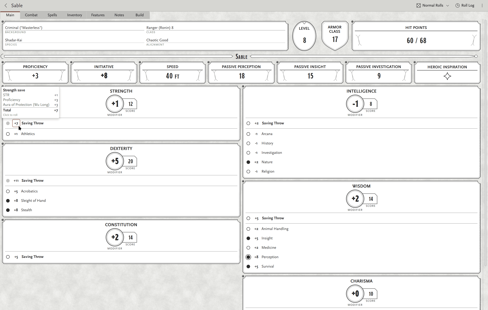
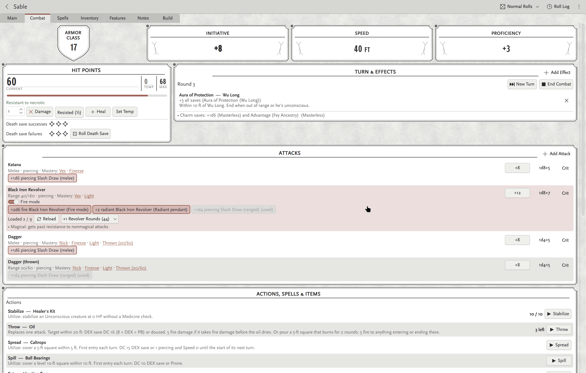
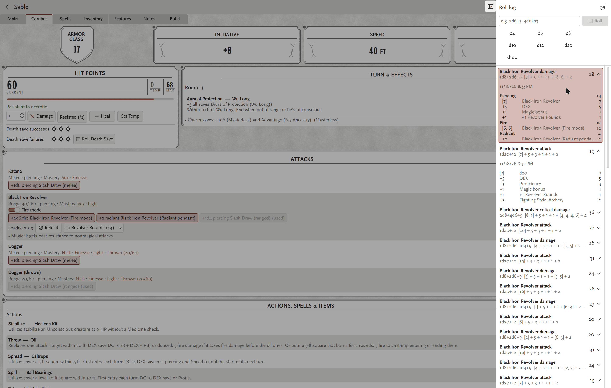
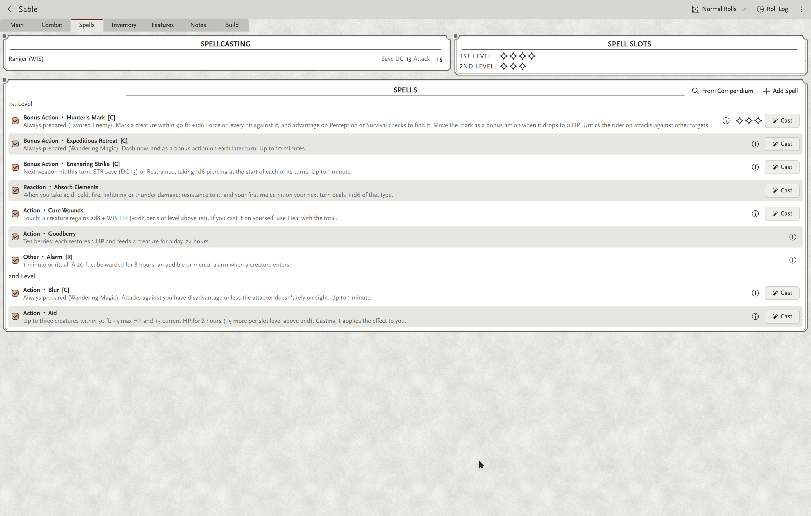
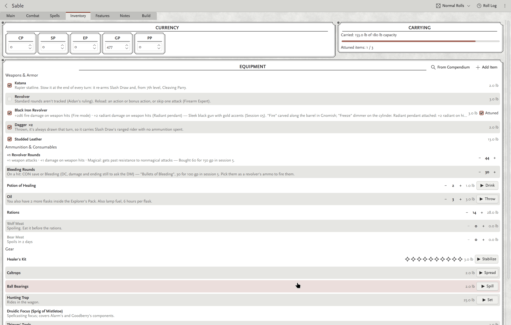
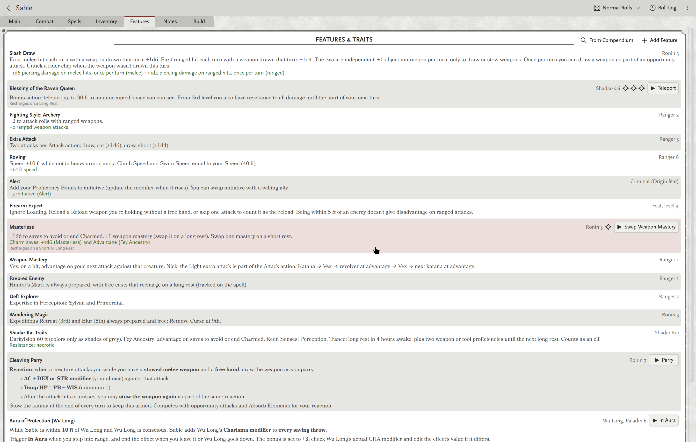

# CharSheet

**A D&D 5e (2024) character sheet that does the math, rolls the dice and keeps up at the table.**

CharSheet is a KDE desktop app written in Rust with Qt 6 and Kirigami
([cxx-qt](https://github.com/KDAB/cxx-qt)). Enter ability scores, classes and gear, and it
works out everything else. Then play straight from the sheet: attack, cast, take damage,
rest, and watch 3D dice tumble across the window.



## Why CharSheet

- **Every number explains itself.** Modifiers, proficiency, saves, skills, AC, initiative,
  spell save DC and attack, and spell slots (including multiclassing and Pact Magic) are
  all derived. Hover any of them to see where it comes from.
- **Click to roll.** Any modifier rolls, with advantage or disadvantage. 3D dice land on the
  rolled numbers, and the roll log splits every total by source and damage type.
- **Built for combat.** The Combat tab is the play surface: the round counter, active
  effects and concentration, attacks with every bonus worked in, and every action grouped
  by Action, Bonus Action and Reaction.
- **Gear that actually does things.** Items, features and spells carry modifiers and
  actions: damage riders, once-per-turn bonuses, toggles, ammunition and reloading,
  charges, healing and effects.
- **The whole SRD 5.2.1 built in.** Search the compendium and add spells, items and
  features with their stats and rules text. Conditions, properties and masteries link
  straight to the rules.
- **AI-ready.** An included MCP server lets an assistant such as Claude read, edit and play
  your characters, and the open sheet updates live.

## A tour

### Combat



HP with temp HP, resistances, damage and healing, and death saves sit next to the turn
tracker and active effects. Equipped weapons become attacks with every modifier included:
here a revolver with a switchable Fire mode, a radiant pendant, choosable ammunition and a
once-per-turn Slash Draw rider that greys out once used.

### The roll log



Every roll, including those made through the MCP server, lands in the log. Expand one to
see each die and bonus, with damage grouped by type. Type any expression, such as
`2d6+3` or `4d6kh3`, to roll it.

### Spells



Spellcasting stats and slots are worked out per class. Each spell shows its casting time,
concentration and ritual tags, free uses and a one-click **Cast** that spends the right slot.

### Inventory



Currency, carrying capacity and attunement are tracked. Items can be equipped, stacked,
spent and used, so drinking a potion or throwing oil is a single click.

### Features



Class features, feats and species traits list their source, uses and the modifiers they
apply. Values that scale, such as proficiency-bonus uses and cantrip dice, follow the
character through **formulas**, and items that recharge at dawn roll for their charges on
a long rest.

## Features at a glance

- Full 2024 rules math: modifiers, proficiency and expertise, saves, skills, passives, AC,
  initiative, spell DC and attack, spell slots with multiclassing and Pact Magic
- Tracking for HP, temp HP, hit dice, death saves, spell slots, feature uses, conditions
  and Exhaustion, with short and long rests
- Modifiers for AC, attack and damage, damage riders (such as Hunter's Mark or Slash Draw),
  speed, saves, max HP, resistances and notes
- Actions that spend uses, charges or quantity, roll dice, heal and apply effects
- 3D dice (turn them off with **3D Dice** in the sheet's menu) and a detailed roll log
- The SRD 5.2.1 compendium, with `srd:` links in Markdown text, such as
  `[Prone](srd:condition:prone)`, opening the rules
- Three themes: *Stone*, styled after the 2024 character sheet, *Parchment*, styled after
  the Player's Handbook, and *System*, which uses your desktop's colors and fonts
- JSON import and export to share characters

Modifiers and actions are filled in from the SRD only where they're certain: from
structured data, or from a hand-checked table that quotes the rules. Everything else stays
as text.

`examples/sable.json` is a complete level 6 Ronin Ranger, the character in the screenshots
at an earlier level; import it from the library page to see everything in use.

## Building

Fedora packages needed:

```sh
sudo dnf install cargo gcc-c++ qt6-qtbase-devel qt6-qtdeclarative-devel qt6-qtquick3d-devel \
    kf6-kirigami kf6-qqc2-desktop-style kf6-kcolorscheme-devel kf6-kconfig-devel
```

Set `KF6_INCLUDE_DIR` if the KDE Frameworks headers aren't in `/usr/include/KF6`.

```sh
cargo run -p charsheet                  # debug build
cargo test -p dnd-core                  # rules engine tests
cargo build --release
```

## Installing for your user

```sh
make install       # builds a release binary and installs to ~/.local
make uninstall     # removes it again; your characters are kept
```

This installs `~/.local/bin/charsheet` and `~/.local/bin/charsheet-mcp` plus the launcher, icon and AppStream metadata, so
CharSheet shows up in the application launcher. Make sure `~/.local/bin` is on your `PATH`.
For a system-wide install use `sudo make install PREFIX=/usr/local`. `DESTDIR` works for
staged (packaging) installs.

Other targets: `make run`, `make test`, `make clean`.

## Usage

```sh
charsheet                               # open the character library
charsheet --open "Brakka" --tab 1       # open a character by name or id on a tab (0-6)
```

The ⋮ menu's Theme entry switches between the *Stone*, *Parchment* and *System* themes.

Characters and their recent dice rolls are stored in a SQLite database at
`~/.local/share/charsheet/charsheet.db`. Use Export/Import on the library page to share a
character as a JSON file.

## MCP server

`charsheet-mcp` is a [Model Context Protocol](https://modelcontextprotocol.io) server over
stdio, so an AI assistant can read, edit and play your characters. To add it to Claude Code:

```sh
claude mcp add charsheet -- ~/.local/bin/charsheet-mcp
```

It works on the same library as the app (`--db <path>` picks another one). Changes are saved
immediately, and the server tells any running app, so a character open there updates at
once.

- **Library:** `list_characters`, `create_character`, `duplicate_character`,
  `delete_character`, `import_character`, `export_character`
- **Reading:** `get_character` (the whole sheet with derived values, or one part by JSON
  Pointer such as `/inventory` or `/derived/weapon_attacks`), `get_catalog` (valid choices)
- **Rules:** `search_srd`, `get_srd`, and `add_from_srd` to put a spell, item or feature on
  a character
- **Editing:** `set_field`, `append_item`, `remove_item`, `move_item` by JSON Pointer
  (`/hp/max`, `/skills/stealth`, `/inventory/2/modifiers`), and `apply_edits` for several
  at once, all or nothing
- **Play:** `damage`, `heal`, `set_temp_hp`, `spend_hit_die`, `short_rest`, `long_rest`,
  `roll`, `get_rolls`, `clear_rolls`, `use_item_action`, `use_feature_action`,
  `cast_spell`, `weapon_attack`, `weapon_damage`, `reload`, `apply_effect`, `end_effect`,
  `new_turn`, `end_combat`

## Layout

- `crates/dnd-core`: the model, rules (SRD 5.2 tables), dice, JSON-pointer edits, play
  actions, storage and the embedded SRD (`src/srd/`). It has no Qt dependency and is
  unit-tested.
- `crates/charsheet`: the Qt app. `src/bridge/` exposes `CharacterLibrary`,
  `CharacterSheet` and `Srd` to QML, and `qml/` holds the Kirigami UI. `cpp/theme.h` applies the
  bundled color schemes in `theme/`, and `qml/SheetFrame.qml` and its neighbours draw the
  sheet decorations. `tools/make_textures.py` generates the background textures.
- `packaging/`: the desktop launcher, icon and AppStream metadata, and
  `docs/screenshots/` the screenshots used here and in the metadata.
- `crates/charsheet-mcp`: the MCP server, built on `dnd-core` with
  [rmcp](https://crates.io/crates/rmcp).
- `data/srd`: the whole SRD 5.2.1 as structured, searchable JSON (spells, monsters, magic
  items, classes, equipment, rules text and more), generated from the SRD PDF by
  `tools/srd` with `make srd` and compiled into `dnd-core`. See `data/srd/README.md` for
  the format.

## License

CharSheet is free software, licensed under the GNU General Public License, version 3 or
(at your option) any later version. See [LICENSE](LICENSE).

This work includes material from the System Reference Document 5.2.1 ("SRD 5.2.1") by
Wizards of the Coast LLC, available at <https://www.dndbeyond.com/srd>. The SRD 5.2.1 is
licensed under the Creative Commons Attribution 4.0 International License, available at
<https://creativecommons.org/licenses/by/4.0/legalcode>. It has been reformatted as
structured data, and the app's rules dialogs credit it.

The bundled fonts in `crates/charsheet/fonts/` are Solbera's 5e font imitations (with fixes
by Ryrok, Ners and LUCASTUCIOUS), licensed under CC-BY-SA-4.0; see the README there.
